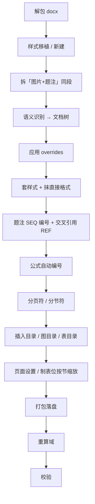

# docxfmt · docx 批量排版引擎

> 直接操作 OOXML，不走 python-docx / HTML 中转 —— 域、书签、批注、图片关系零损坏。
> 规范驱动：换模板 = 换一份 JSON，代码一行不改。
> 层级判断交给 AI：**工具挑疑点，人拍板。**

---

## 一、这个项目解决什么问题

### 真实场景

手头有一批长文档（学位论文、中期报告、项目申报书），要求是：

统一正文/标题/题注样式 · 自动生成目录与图表目录 · 图表题注自动编号 ·
正文交叉引用跟着变 · 公式自动编号 · 按章节分节 · 横向宽表单独成节 · 页眉页脚……

这些要求**单独看都不难，合起来会互相打架**：

- 补一个图号 → 正文里 40 处「如图 X 所示」要跟着变
- 调一次页边距 → 版心宽度变了，制表位必须按新宽度重算，否则内容溢出页面
- 插一个新目录 → 旧目录留下的 `_Toc*` 书签全部断链，满屏「错误！未定义书签」
- 加一个章节 → 分章编号的图表号整体重排

一份人工做要几天，一批就是灾难。这就是本项目的起点。

### 为什么不用现成方案

| 方案 | 致命问题 |
|---|---|
| **python-docx** | 不支持域（field）。写出来的目录是**死文字**，页码永远不会更新 |
| **HTML → docx 中转** | 丢域 / 书签 / 批注。实测一份 63MB 文档：**96 个 SEQ 题注、101 个 REF、147 个 PAGEREF、148 个 HYPERLINK 全部无法保真** |
| **整体复制模板 styles.xml** | 语义错位。styleId 是**每个文档一套编号**，WPS 保存还会把语义 styleId 重写成数字 → 出现「styleId=5 的段落从题注变成标题 4」 |
| **按 styleId 判断标题级别** | 同上。同一份文档换个软件保存一次，styleId 就全变了 |

结论只有一条：**必须直接操作 OOXML，必须按语义（`w:name`）定位。**

---

## 二、三根支柱

### 支柱 1 · 直接操作 OOXML

docx 本质是一个 zip。工具解开它 → 用 lxml **原地修改** `word/document.xml`、
`styles.xml`、`numbering.xml` → 打包回去。

不走 python-docx，不走 HTML 中转。**域、书签、批注、图片关系原样保留。**

> 树只是逻辑视图：每个节点持有原 lxml 元素的引用，只改不改写。
> 一旦按树重新生成 XML，域 / 书签 / 批注 / 图片关系全丢。

### 支柱 2 · 规范驱动，而不是代码驱动

一份 JSON spec 描述「要排成什么样」，工具照做。

**换模板 = 换一份 spec，代码一行不改。**

spec 里写的是 `w:name` **语义名**（「标题 1」「题注」「图片」），不是 styleId。
所以「照中文模板排」和「照英文模板排」共用同一套配置 —— 工具会自动做别名解析。

### 支柱 3 · 层级判断交给 AI ⭐

**这是本项目与普通脚本最本质的区别。**

规则永远补不完。有些标题**所有逐段信号都没有**：不套 heading 样式、无 `outlineLvl`、
文字里也没有编号（例如「某某技术」）。想用「短段落」猜？表格单元格天生就短 ——
试过一版，260 个候选里混进一堆实验数据 `0.7561`、公式编号 `(42)`、日期，直接报废。

所以分工是：

| 谁 | 干什么 |
|---|---|
| **工具** | 确定性判断（有样式依据的、正则能匹配的）+ **挑出「拿不准的」，附上前后文** |
| **AI / 人** | 读上下文，对层级语义**亲自拍板** |

回路本身很短：

```bash
python -m docxfmt propose in.docx -o 待拍板.json        # ① 工具挑疑点，每条约 2 段上下文
#        ↓ 停在这里，逐条读 JSON 判断层级，写进 overrides
python -m docxfmt run in.docx -o out.docx --overrides 判断.json   # ② 工具按你的判断渲染
```

同一份真实文档，走不走这个回路的差距：

| | 纯规则 | 走完判断回路 |
|---|---|---|
| 识别出的标题数 | 67 | **131** |
| 层级分布 | L1=9 L2=10 L3=13 L4=35 **L5=0** | L1=8 L2=18 L3=27 L4=58 **L5=20** |
| 正文目录 | 只有章节 | **完整三级 + 页码** |

多出来的 64 个标题（含 20 个 L5，都是「某某平台 / 某某系统」这类技术名）
是规则完全认不出、由判断环节补上的。

> **判断要克制。** 拿不准的保持工具的判断，只改「看起来明显不对的」。
> 乱改比不改更糟 —— 详细的判断方法见 `SKILL.md` 的「③ 怎么判断」。

---

## 三、流水线



**顺序有讲究，不能乱**：

- **拆段必须最早** —— 拆「图片+题注同段」会改变段落序号，晚于识别会让 overrides 全部对不上
- **应用 overrides 在建树之后、渲染之前** —— 判断结果要以段落序号为键
- **页面设置要晚于制表位快照** —— 边距一改版心就变，制表位必须按新宽度重算
- **目录要早于页面设置** —— 目录段落自己也有制表位，同样要缩放

---

## 四、能力

| 能力 | 实现 | 备注 |
|---|---|---|
| **自动套样式** | `render.py` | 按语义角色分配：正文 / 标题 1-6 / 题注 / **图片** / 表格文字 / 目录标题 / 目录 1-3 / 附录 / 公式编号 |
| **图片样式** | `spec.styles.new_styles` | 独立样式，默认**无首行缩进 + 居中**（不是正文样式） |
| **题注样式** | 同上 | 独立样式，模板没有就新建 |
| **目录标题样式** | 同上 | 独立样式，默认**居中 + 无首行缩进**，与正文区分 |
| **插入目录** | `TOC \o "1-3" \h \z \u` | 层级可配，插在第一个一级标题前 |
| **插入图目录 / 表目录** | `TOC \h \z \c "图"` | 按 SEQ 标识符收集，与题注自动对齐 |
| **分页符** | `pPr/pageBreakBefore` | 按标题级别配，不靠插空段落 |
| **分节符** | `pPr/sectPr` | 支持指定级别前分节、指定标题单独成横向节 |
| **页面设置** | 边距 / 方向 / 首页不同 / 奇偶页 | 横向节可保留（宽表改纵向会溢出） |
| **页眉页脚** | `header` / `footer` | 随模板移植 |
| **题注自动编号** | `SEQ 图` / `SEQ 表` | global（图 1）/ chapter（图 2-1）可切换 |
| **交叉引用** | `REF _figN \h` | 按作者原编号精确匹配，实测零错位 |
| **公式自动编号** | `SEQ 式` | 兼容「编号同段」与「编号独立成段」两种形态 |
| **分章编号** | `SEQ 章 \h` + `\s 1` | 章号锚点只插正文，引言/附录不占号 |
| **域重算 + 三层校验** | `winfield.py` / `verify.py` | 真机打开 → 重算 → 再校验 |

---

## 五、实测

在两份真实文档上跑通（**均为脱敏统计，不含原文内容**）。

**文档 A：39MB / 8 节（含 4 横向）/ 33 表 / 49 图 / 2564 段**

```
[styles]  移植模板样式：覆盖 13，新增 12，basedOn 重映射 7
[parse]   封面区 [0,21)；9 个一级标题 / 15 二 / 13 三 / 35 四
[render]  套样式 1552 段
[caption] 题注 59 条（图 38 / 表 21），认领孤儿书签 1
[xref]    交叉引用 40 处；原编号命中 33 / 占位符就近 4 / 方位就近 3
[toc]     插图目录 + 表目录 + 正文目录（真 TOC 域）
[page]    8 个节全部应用，横向节保留方向
[tabs]    缩放 5 个段落 6 个制表位（按节版心，不是全局 max）
```
重算域后：图目录 38 条、表目录 21 条、正文目录三级全带页码；
SEQ 图 1..38 / SEQ 表 1..21 连续；REF 134 处**零断链**；媒体/表格/图片/分节**零丢失**。

**文档 B：63MB / 4 节 / 52 表 / 45 图 / 4385 段（分章编号 + 公式编号）**

```
[styles]  新建样式 ['目录标题','图片','公式编号']
[parse]   封面区 [0,154)；8 个一级标题 / 15 二 / 28 三 / 41 四
[render]  套样式 1021 段（3273 段表格文字自动降级正文 —— 该文档无表格文字样式）
[caption] 分章编号：插入隐藏 SEQ 章 锚点 4 个（引言/总结/附录不占号）
[caption] 题注 97 条（图 45 / 表 52）
[formula] 公式编号转 SEQ 域 75 处（原文是独立成段的 (1)(2)(3)…）
[toc]     删除旧目录块 2 处 → 插图目录 + 表目录 + 正文目录
```
完整性：媒体/表格/图片/分节**零丢失**，REF 248 处**零断链**。

---

## 六、快速上手

```bash
# ① 侦查（只读，永远先跑）
python -m docxfmt inspect 输入.docx

# ② 挑出拿不准的 + 附上下文 → 由 AI/人定层级
python -m docxfmt propose 输入.docx -o 待拍板.json

# ③ 排版（可带 --template 直接照模板排）
python -m docxfmt run 输入.docx -o 输出.docx --spec my.json --overrides 我的判断.json

# ④ ⚠️ 必须重算域：目录/图表目录/题注号/引用全是域，不重算还是旧值
python -m docxfmt fields 输出.docx -o 输出_域重算.docx

# ⑤ 校验
python -m docxfmt verify 输出_域重算.docx --template 模板.docx
```

不想写 spec 时可用快捷参数：
`--template PATH`（照模板排）· `--caption-scheme chapter`（分章编号）·
`--pagebreak-levels 1,2` · `--toc --figure-list --table-list` ·
`--no-captions --no-xref --no-toc` · `--dry-run` · `--tree-json / --tree-txt`

### spec 长什么样

`spec/from-template.json` 与 `spec/chapter-numbering.json` 是两份可直接改的样例。
核心字段：

```jsonc
{
  "source":   { "style_from": "template|requirement|keep", "template": "参考模板.docx" },
  "styles":   {
    "map":        { "paragraph": "正文", "heading": {"1": "标题 1"},
                    "caption": "题注", "image": "图片", "table_text": "表格表头文字",
                    "toc_title": "目录标题", "toc": {"1": "目录 1"},
                    "formula_number": "公式编号" },
    "new_styles": { "图片": {"align": "center", "first_line": 0} },
    "geometry":   { "题注": {"size": 15, "font": "仿宋"} }
  },
  "numbering": { "caption": "global|chapter|none", "formula": "none|global|chapter",
                 "sep": "-", "skip_keywords": ["引言", "附录"] },
  "toc":         { "enabled": true, "levels": "1-3", "title": "目录" },
  "figure_list": { "enabled": true, "title": "插图清单" },
  "table_list":  { "enabled": true, "title": "附表清单" },
  "pagebreak":   { "before_heading": [1], "keep_with_next": true },
  "section":     { "insert": [1], "landscape_nodes": ["附表"] },
  "page":        { "margin": {"top": 1440, "bottom": 1440, "left": 1701, "right": 1701} }
}
```

---

## 七、设计铁律（都是踩坑换来的）

1. **直接操作 OOXML**，不走 python-docx / HTML 中转。
2. **一切按 `w:name` 定位，绝不按 styleId，也绝不复制模板的 styles.xml。**
3. **树是逻辑视图，不重建 OOXML。** 节点持有原元素引用，只改不改写。
4. **OOXML 写对了 ≠ 渲染对，必须真机打开验证。**
5. **改编号 / 插目录后必须重算域。** 不重算就还是旧值。

### 实现层的几个硬经验

| 坑 | 症状 | 修法 |
|---|---|---|
| 封面区按「第一个一级标题」算，但只认「一、」 | 纯数字编号的论文（`1.` `1.1`）一个都找不到 → 退化到全文 → **整篇 4136 段被当封面跳过** | 优先认「已套 heading 1 样式 / `outlineLvl=0`」，其次「一、」，再次「1.」+ 加粗佐证 |
| 空标题段当封面终点 | 一个**空的** heading 1 把封面区截断了 | 封面终点要求段落非空 |
| 用「短段落」猜裸标题 | 表格数据 `0.7561`、公式编号 `(42)`、日期全被当选 | 废弃该路线；表格单元格天生就短，**长度不是信号** |
| 小节号正则用 `\d+\.\d+` | 表格数据 `0.7084` 被判成「0.70 小节」，**1578 个单元格全炸** | 改为 `[1-9]\d?\.[1-9]\d?`（整数部分从 1 起） |
| 裸标题通道抢既有样式的段 | heading2 从 15 掉到 0 | 加「无任何其他标题信号」门禁 |
| 整段重写公式段落 | **417 个 OMML 公式掉到 342** | 只删末尾编号 run，永不整段重写 |
| 表格文字样式不存在 | 3273 段全不套样式 | 自动降级正文，日志报 `_退回正文=N` |
| 旧目录没删全 | 新旧并存，`_Toc*` 引用断链 96 处 | 吞掉整块连续条目；**静态文字目录保留并警告**（域刷不了它，删了内容就没了） |
| 引用正则太松 | 「如**图**像、语音」被当成「如图」引用 | 正则必须带编号 |
| 章节归属算成 O(n²) | 2500 段直接卡死 | 一次遍历同时算「最近标题」和「最近一级标题」 |
| 校验脚本口径自相矛盾 | 报「43 处引用全不一致」 | SEQ 域结果是纯数字 `1`，REF 显示是「图 1」→ 只能比数字 |
| lxml 元素真值判断 | `elem or other` 在新版 Python 会变 False | 全部改 `is not None` |

---

## 八、已知限制

- **静态文字目录刷不了**：源文档目录若是纯文字（无 TOC 域），程序无法更新页码。
  工具会识别并警告，需人工更新，或设 `toc.replace_static=true` 让工具删掉重建。
- **WPS 劫持 Word COM**：本机 `Word.Application` 被 WPS 接管，只能走 WPS，
  渲染与真 Word 有细微差异。
- **超大文档重算域慢**：60MB 级以上 WPS 要跑几分钟，命令行会超时，建议后台执行。
- **尚未实现**：插入批注（`comments.xml`）、页眉文案自动生成、
  图表编号用 `TOC \t "题注,1"` 旧式收集。

---

## 九、目录结构

```
docxfmt/
├── __main__.py      python -m docxfmt 入口
├── cli.py           命令行（inspect / propose / spec / run / fields / verify）
├── spec.py          规范定义（工具的输入契约）
├── docxio.py        解包 / 打包 / OOXML 构造
├── styles.py        样式表（按 w:name 索引、移植、几何、新建）
├── recognize.py     语义识别 → 文档树
├── propose.py       ⭐ 挑出疑点 + 上下文；应用 overrides
├── render.py        套样式 + 抹直接格式 + 样式降级
├── toc.py           目录 / 图目录 / 表目录
├── layout.py        页面 / 分节 / 分页符 / 制表位
├── captions.py      题注 SEQ + 交叉引用 REF + 公式编号
├── pipeline.py      主流水线（顺序有讲究，别改）
├── verify.py        三层校验
└── winfield.py      COM 重算域（独立进程）

spec/
├── from-template.json        照模板排
└── chapter-numbering.json    分章编号 + 公式编号
```

---

MIT License · 详见 `LICENSE`
