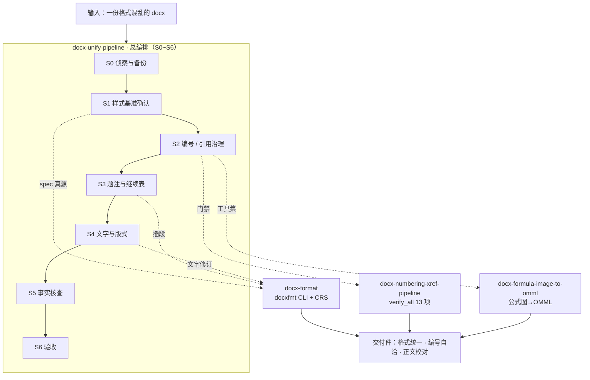

# docx-skills

面向**中文长文档**（技术报告、学位论文、项目申报书、结题报告）的 Word 处理工具链。

针对的场景是「**内容已经成稿，格式很乱**」：标题层级不统一、图表题注重复跳号、交叉引用点了不动、公式是图片、目录页码不对、编号与正文引用对不上。

四个 skill 全部**直接操作 OOXML**（`word/document.xml` 及其关系文件），不经 `python-docx` / HTML 中转，因此**域（`fldChar`）、书签、批注、图片关系零损坏**。

---

## 四个 skill 的分层

| skill | 层级 | 职责 | 主要入口 |
|---|---|---|---|
| **`docx-format`** | 权威实现层 | 排版规范（JSON spec）的**唯一真源**；样式移植、正文/标题/题注套样、目录、分页分节、页眉页脚；修订落盘；**CRS 的唯一实现** | `python -m docxfmt` — `run` / `styles` / `lint` / `revise` / `polish` / `captions` / `facts` / `propose` / `inspect` / `fields` / `spec` / `verify` |
| **`docx-unify-pipeline`** | **总编排层** | 把一份乱格式长文档端到端捋顺：**七阶段 S0~S6** + 状态账本 + 多来源 CRS 合并 | `scripts/pipeline_state.py`（`init` / `set` / `artifact` / `check` / `gate` / `next` / `status`）、`scripts/crs_merge.py` |
| **`docx-numbering-xref-pipeline`** | 编排与门禁层（编号域） | 图表题注编号、交叉引用、图/表清单、公式编号的系统治理；**13 项验收门禁** | `scripts/verify_all.py`、`scripts/make_crs.py`、`scripts/add_ref_bookmark.py` |
| **`docx-formula-image-to-omml`** | 工具实现层 | 图片公式 → 可编辑 Word 公式（OMML）；行间公式连续编号；题注 / 交叉引用 / 字符级（伪角标、中英空格）修复 | `scripts/1_classify.py` … `6_renumber_display.py` + 一批 `fix_*` / `verify_*` |

**缺能力就往对应层加，不新建平行实现** —— 两套并行必然跑出两种结果。

## 协作关系



## 三条硬约定

**1. JSON spec 是「要排成什么样」的唯一真源。**
换模板 / 换规范 = 换 JSON，**不加代码分支**。样式一律按 `w:name` **语义名**定位，绝不按 `styleId`，绝不复制模板的 `styles.xml`。

**2. 写盘前必须先出「改动事项单（CRS）」并取得批准。**
`styles` / `lint` / `inspect` 等只读命令不受限；任何写盘动作都要先给可勾选清单，拿到逐条批准后才执行（只执行 `approved` / `modified` 项，未勾选项记入回执「未勾选未改」栏）。**沉默不是同意。**

**3. 改动一律走修订模式 + 逐条批注。**
`w:ins` / `w:del` 承载改动，理由写进 `w:comment`；`w:del` 内的文本必须落在 `<w:delText>`。`revise` 的不变量：`w:p` / `w:tbl` / `w:drawing` / 书签 / `fldChar` 计数**全不变**。

## 退出码（全链路统一）

| 码 | 含义 |
|---|---|
| `0` | 成功 |
| `2` | 验收失败 |
| `3` | 无 CRS |
| `4` | 闸门未满足 |
| `5` | 指纹不符（需重新出单） |
| `6` | 用法错误 |

## 安装

四个 skill 都是 WorkBuddy 用户级 skill，放在 `~/.workbuddy/skills/` 下即可被识别。依赖 Python 3.13+；以标准库为主，部分脚本需要 `python-docx` 与 `Pillow`：

```bash
pip install python-docx Pillow
```

## 使用

**单点处理**（以规范化排版为例，在 `docx-format/` 目录下运行）：

```bash
cd ~/.workbuddy/skills/docx-format

# 1) 只读：出样式基准，确认「要排成什么样」（S1）
python -m docxfmt styles <文档.docx> --out spec.json --html 样式确认单.html

# 2) 只读：正文体检，把所有不符合规范的点落成改动事项单 CRS
python -m docxfmt lint <文档.docx> --spec spec/default.json \
    --out 改动事项单.json --html 改动事项单.html

# 3) 人工逐条勾选批准后，按 CRS 走修订模式落盘（S6）
python -m docxfmt revise <文档.docx> --crs 改动事项单.json \
    -o <修订稿.docx> --receipt 回执.md
```

**端到端编排**（七阶段）：

```bash
cd ~/.workbuddy/skills/docx-unify-pipeline
python scripts/pipeline_state.py init "<文档.docx>"     # 建账本
python scripts/pipeline_state.py check --stage S6       # 写盘前必跑的门禁
```

**编号与交叉引用验收**：

```bash
cd ~/.workbuddy/skills/docx-numbering-xref-pipeline
python scripts/verify_all.py <文档.docx> [--base <改前备份.docx>] [--stage {s2,s6}]
# 13 项检查：1~11 恒跑；12/13 仅在给了 --base 时跑。
# --stage 默认 s2（严格）；s6 时把 12/13 记为 EXPECT（属预期，不计失败）。
```

## 一类量不出来的问题

「大范围空白 / 单字独占一行 / 题注与图表不同页」**无法从静态 XML 量出来**，必须导出 PDF 后量页（依赖 Word / WPS COM）。拿不到 COM 时只输出**建议位置清单**，不自动改。

## 许可

MIT License，见 [LICENSE](LICENSE)。
